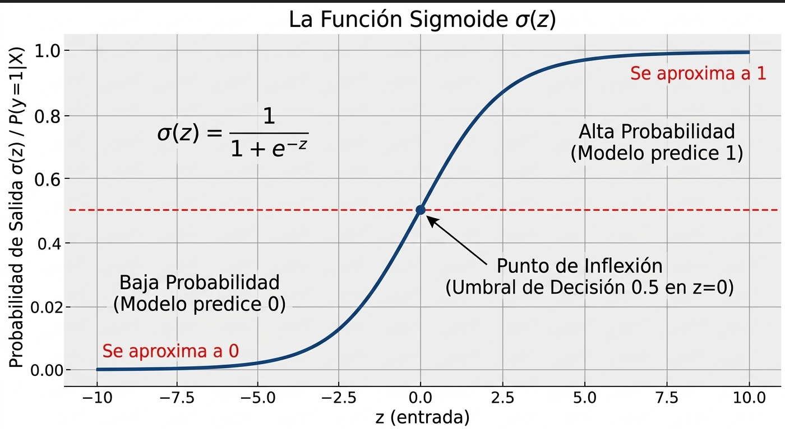
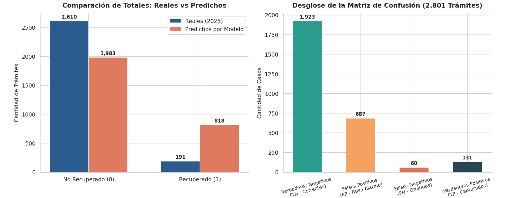

## 📊 Caracterización y Ficha Técnica del Dataset

### 1. Cuantificación y Distribución de Clases
* **Dataset Crudo Consolidado:** 24.718 registros y 25 columnas originales.
* **Tratamiento de Valores Faltantes:** Se detectaron 48 nulos en `automotor_anio_modelo` (0,19%) e imputación por mediana; 493 nulos en `registro_seccional_provincia` (1,99%) e imputación por moda. Se descartaron 540 registros con nulos (2,18% del total).
* **Dataset Procesado:** 24.178 registros completos y 5 columnas seleccionadas para el modelado.
* **Distribución de la Variable Objetivo (`recuperado`):**
  * **Clase 0 (No Recuperado / Otros trámites):** **94,88%** (22.941 registros procesados | 23.463 en crudo).
  * **Clase 1 (Recuperado):** **5,12%** (1.237 registros procesados | 1.255 en crudo).
  * *Diagnóstico:* **Desbalance severo de clases** (~95% vs ~5%).

---

### 2. Diccionario Completo de Variables

#### 📄 A. Variables del Dataset Crudo Original (25 Columnas DNRPA)

| Variable | Tipo de Dato | Naturaleza | Descripción | Estado / Justificación para el Modelo |
| :--- | :--- | :--- | :--- | :--- |
| **tramite_tipo** | Texto (`str`) | Categórica Nominal | Tipo de trámite registral (ej. 'DENUNCIA DE ROBO O HURTO', 'RECUPERO'). | Base para construir la variable objetivo `recuperado`. |
| **tramite_fecha** | Fecha (`date`) | Temporal | Fecha de realización del trámite registral. | Descartada (prevención de *data leakage*). |
| **fecha_transferencia** | Fecha (`date`) | Temporal | Fecha de inscripción o transferencia del automotor. | Descartada (incompleta/no relevante para el objetivo). |
| **titular_tipo_persona** | Texto (`str`) | Categórica Nominal | Tipo de titular registral (Física / Jurídica). | Descartada (alta proporción de nulos/redundante). |
| **titular_domicilio_posicion_fiscal_id** | Numérico (`float`) | Categórica | Identificador de posición fiscal del domicilio del titular. | Descartada. |
| **titular_domicilio_provincia_id** | Numérico (`float`) | Categórica | Código identificador de provincia del titular. | Descartada. |
| **titular_domicilio_provincia_descripcion** | Texto (`str`) | Categórica Nominal | Provincia de residencia del titular registral. | Descartada. |
| **titular_porcentaje_titularidad** | Numérico (`int`) | Discreta | Porcentaje de titularidad sobre el vehículo (1 a 100%). | Descartada. |
| **titular_pais_nacimiento_id** | Numérico (`float`) | Categórica | Código del país de origen/nacimiento del titular. | Descartada. |
| **titular_pais_nacimiento_descripcion** | Texto (`str`) | Categórica Nominal | País de origen/nacimiento del titular registral. | Descartada. |
| **automotor_marca_codigo** | Texto (`str`) | Categórica Nominal | Código identificador de la marca del automotor. | Redundante con la descripción de marca. |
| **automotor_marca_descripcion** | Texto (`str`) | Categórica Nominal | Marca comercial del vehículo (ej. Ford, Fiat, Volkswagen). | Descartada (alta cardinalidad sin agrupar). |
| **automotor_modelo_codigo** | Texto (`str`) | Categórica Nominal | Código identificador del modelo. | Redundante con descripción. |
| **automotor_modelo_descripcion** | Texto (`str`) | Categórica Nominal | Modelo específico del vehículo. | Descartada (alta cardinalidad). |
| **automotor_tipo_codigo** | Texto (`str`) | Categórica Nominal | Código del tipo/carrocería de vehículo. | Redundante con descripción. |
| **automotor_tipo_descripcion** | Texto (`str`) | Categórica Nominal | Tipo y carrocería del automotor (Sedán, Pick-up, Colectivo, etc.). | **SELECCIONADA ($X$)** |
| **automotor_anio_modelo** | Numérico (`float`) | Discreta | Año de modelo/fabricación del automotor según registro. | **SELECCIONADA ($X$)** |
| **automotor_origen** | Texto (`str`) | Categórica Nominal | Origen de fabricación (Nacional / Importado / Subastado). | **SELECCIONADA ($X$)** |
| **automotor_uso_codigo** | Texto (`str`) | Categórica Nominal | Código del uso asignado al vehículo. | Redundante con descripción. |
| **automotor_uso_descripcion** | Texto (`str`) | Categórica Nominal | Descripción del uso (Particular, Oficial, Transporte, etc.). | Descartada. |
| **registro_seccional_codigo** | Numérico (`int`) | Categórica Nominal | Código identificador de la seccional registral. | Redundante con provincia. |
| **registro_seccional_descripcion** | Texto (`str`) | Categórica Nominal | Nombre de la seccional registral. | Redundante con provincia. |
| **registro_seccional_provincia** | Texto (`str`) | Categórica Nominal | Provincia de radicación registral (24 jurisdicciones). | **SELECCIONADA ($X$)** |
| **provincia_id** | Numérico (`int`) | Categórica Nominal | Código de provincia registral. | Redundante. |
| **recuperado** | Numérico (`int`) | Binaria | Variable objetivo construida (1: Recupero, 0: Otros trámites). | **VARIABLE OBJETIVO ($y$)** |

---

#### ⚙️ B. Variables Seleccionadas y Procesadas para el Modelo (5 Columnas)

| Variable | Rol en el Modelo | Tipo de Dato | Naturaleza | Descripción y Tratamiento en Pipeline |
| :--- | :--- | :--- | :--- | :--- |
| **automotor_anio_modelo** | Predictor ($X$) | Numérico (`float`) | Discreta | Año de modelo/fabricación del automotor según registro. Imputación por mediana y `StandardScaler`. |
| **automotor_origen** | Predictor ($X$) | Categórico (`str`) | Nominal | Origen de fabricación (Nacional / Importado / Subastado). Codificado con `OneHotEncoder`. |
| **automotor_tipo_descripcion** | Predictor (`str`) | Categórico (`str`) | Nominal | Tipo y carrocería del automotor (Sedán, Pick-up, Colectivo, etc.). Codificado con `OneHotEncoder`. |
| **registro_seccional_provincia** | Predictor (`str`) | Categórico (`str`) | Nominal | Provincia de radicación registral (24 jurisdicciones). Codificado con `OneHotEncoder`. |
| **recuperado** | Objetivo ($y$) | Binario (`int`) | Nominal | **1:** Trámite de Recupero (5,12%) \| **0:** Otros trámites registrales (94,88%). |

---

## ⚙️ Metodología, Preprocesamiento y Prevención de *Data Leakage*

1. **Partición Estratificada Train/Test (80/20):**
   * **Entrenamiento ($X_{train}$):** 19.342 registros (80%).
   * **Prueba ($X_{test}$):** 4.836 registros (20%).
   * Se utilizó `stratify=y` para mantener exactamente la proporción de la clase minoritaria (5,12%) en ambos subconjuntos.

2. **Aislamiento del Preprocesamiento (`Pipeline` & `ColumnTransformer`):**
   * Todo el flujo de preprocesamiento se encapsuló en un `ColumnTransformer` dentro de un `Pipeline` de `scikit-learn`.
   * Los estimadores e imputadores (`SimpleImputer`, `StandardScaler`, `OneHotEncoder`) aprendieron sus parámetros exclusivamente sobre $X_{train}$ (`fit`) y se transformó $X_{test}$ sin fuga de información (*data leakage*).

3. **Manejo del Desbalance Severo:**
   * Se configuró el hiperparámetro `class_weight='balanced'` en ambos clasificadores para penalizar en la función de pérdida los errores cometidos sobre la clase minoritaria.

---

## 📌 Aclaraciones Conceptuales y Alcance

* Se trabajó sobre la totalidad del período disponible Enero 2026 a Septiembre 2026  (24.718 registros crudos / 24.178 procesados).
* **Interpretación de `automotor_anio_modelo`:** Representa formalmente el **año de modelo o fabricación** asignado registralmente al automotor; no debe calcularse ni interpretarse como la antigüedad del vehículo.
* **Proporciones Provinciales:** Los porcentajes por provincia representan la **proporción de trámites etiquetados como 'RECUPERO' sobre el total de trámites registrales de las seccionales de esa provincia** en el dataset, y no constituyen la tasa global de recuperación de vehículos robados en dicha jurisdicción.
* **Simplificación Académica y Alcance del Modelo:** La variable objetivo se construyó asignando `1` a trámites con la denominación 'RECUPERO' y `0` a otros trámites registrales de la DNRPA. El modelo clasifica patrones administrativos y de flota asociados a dichos registros; **sus métricas no deben interpretarse como una probabilidad comprobada de recupero futuro frente a un vehículo recién sustraído.**

---

## 📈 Resultados y Comparativa de Modelos

Evaluación sobre el conjunto de prueba independiente ($X_{test}$ = 4.836 registros: 4.589 clase 0 y 247 clase 1):

| Modelo | Accuracy Global | Precision (Clase 1) | Recall (Clase 1) | F1-Score (Clase 1) | **ROC-AUC Score** |
| :--- | :---: | :---: | :---: | :---: | :---: |
| **Regresión Logística** (`class_weight='balanced'`) | 0,70 | 0,11 | **0,69 (69,2%)** | 0,19 | **0,7580** |
| **Árbol de Decisión** (`max_depth=5`, `class_weight='balanced'`) | 0,71 | 0,11 | 0,68 (68,0%) | 0,19 | 0,7546 |

---

### 🔍 Matrices de Confusión ($X_{test}$)

#### Regresión Logística
* **Verdaderos Negativos (TN):** 3.198
* **Falsos Positivos (FP):** 1.391
* **Falsos Negativos (FN):** 76
* **Verdaderos Positivos (TP):** 171 (Identifica 171 de los 247 recuperos reales).

#### Árbol de Decisión (`max_depth=5`)
* **Verdaderos Negativos (TN):** 3.264
* **Falsos Positivos (FP):** 1.325
* **Falsos Negativos (FN):** 79
* **Verdaderos Positivos (TP):** 168 (Identifica 168 de los 247 recuperos reales).

---

### 📉 Compromiso Precision-Recall y Umbral de Decisión
* El análisis del trade-off Precision-Recall según el umbral de decisión demuestra que en el umbral estándar de 0,50 con `class_weight='balanced'`, el modelo prioriza maximizar la Sensibilidad (**Recall = 69,2%**), aceptando una menor Precisión (**11%**) típica del sesgo provocado por el desbalance natural (~5%).
* El punto de intersección donde equilibra ambas métricas se ubica cercano a un **umbral de 0,80** (alcanzando ~19%-20% en ambas métricas).

---

###  Selección del Modelo
Aunque los dos modelos arrojan métricas similares, se selecciona la **Regresión Logística** como el modelo para el problema planteado, al obtener el mayor **ROC-AUC (0.7580)** y el mayor **Recall sobre la clase de interés (69,2%)**, ofreciendo además alta interpretabilidad de coeficientes y un comportamiento libre de sobreajuste.

## Resumen Metodológico y Evaluación del Modelo de Regresión Logística---

La **Regresión Logística** es un algoritmo de aprendizaje supervisado lineal diseñado para resolver problemas de clasificación binaria o multiclase. 

* **Estimación Probabilística:** En lugar de predecir directamente una categoría discreta, estima la probabilidad continua $P(y=1|X)$ de que una observación pertenezca a la clase de interés a través de una combinación lineal ponderada de las variables predictoras ($X$) y la aplicación de la función sigmoide:
  $$\sigma(z) = \frac{1}{1 + e^{-z}}$$

* **Umbral de Decisión:** Para transformar dicha probabilidad continua en una clasificación binaria final ($0$ o $1$), el modelo aplica un umbral probabilístico de corte (por defecto $0.50$).
* **Tratamiento del Desbalance:** En escenarios con desbalance severo de clases, se incorpora el parámetro `class_weight='balanced'`, el cual ajusta la función de costo penalizando los errorn la clase minoritaria para incrementar la sensibilidad (*Recall*) del modelo.
* **Interpretabilidad:** Permite analizar el impacto y la dirección de cada variable predictora sobre la probabilidad final mediante la inspección de los coeficientes $\beta$ aprendidos.

---

## 2. Aplicación al Dataset del Proyecto (Entrenamiento y Evaluación en $X_{test}$)

* **Caracterización del Dataset:** El modelo fue entrenado sobre un dataset procesado de **24.178 registros limpios** correspondientes a trámites registrales automotores. Presenta un desbalance severo de clases: **94,88% para No Recuperados ($y=0$)** frente al **5,12% para Recuperados ($y=1$)**.
* **Preprocesamiento y Prevención de *Data Leakage*:** Todo el flujo de transformación (imputación por mediana, escalado numérico con `StandardScaler` y codificación cat con `OneHotEncoder`) se encapsuló en un `ColumnTransformer` dentro de un `Pipeline` ajustado exclusivamente sobre $X_{train}$.
* **Evaluación sobre $X_{test}$ Independent (4.836 registros):** Mediante una división 80/20 estratificada (`stratify=y`), se evaluó el desempeño en la partición de prueba ($4.589$ clase $0$ y $247$ clase $1$) :
  * **ROC-AUC Score:** *0.7580*
  * **Recall (Clase 1):** 69,2% (identifica $171$ de los $247$ recuperos reales) 
  * **Precision (Clase 1):** **11,0%** 
  * **Accuracy Global:** **70,0%** 
  * **Matriz de Confusión ($X_{test}$):** $TN = 3.198$, $FP = 1.391$, $FN = 76$, $TP = 171$

---

## 3. Prueba y Validación Temporal sobre un nuevo dataset 2025
Para realizar una prueba del modelo se utilizó un nuevo dataset. Este dataset  corresponde al mes de diciembre del año 2025.  Lo ideal hubiera sido contar con el archivo del octubre 2026 el cual no se encuentra disponible aún, por lo tanto para realizar la prueba del modelo con datos reales se opta por utilizar ese nuevo dataset. Esto nos da también una ventaja ya que podemos comparar la variable real verusus la predicción del modelo.

Para evaluar la capacidad de generalización del `Pipeline` ajustado frente a flujos de datos no vistos durante el entrenamiento, se ejecutó una inferencia sobre **2.801 registros independientes del período Dic-2025**:

* **Métricas en Datos 2025:**
  * **ROC-AUC Score:** **0.7751** (presenta un leve incremento respecto al 0.7580 obtenido en $X_{test}$).
  * **Recall (Clase 1):** **68,6%** (demuestra una consistencia exacta al capturar $131$ de los $191$ recuperos reales).
  * **Precision (Clase 1):** **16,0%** (se eleva un +5% favorecida por la tasa de prevalencia del nuevo mes).
  * **Accuracy Global:** **73,0%**.
* **Matriz de Confusión (2025):**
  $$\begin{bmatrix} 1923 & 687 \\ 60 & 131 \end{bmatrix}$$
  * **Verdaderos Negativos (TN):** $1.923$ trámites no recuperados correctamente clasificados.
  * **Falsos Positivos (FP):** $687$ trámites no recuperados clasificados preventivamente como recupero.
  * **Falsos Negativos (FN):** $60$ trámites de recupero omitidos por el modelo.
  * **Verdaderos Positivos (TP):** $131$ trámites de recupero correctamente identificados.
  * En este gráfico se puede observar una comparacion entre los datos reales y lo predicho por el modelo.
  * 

* La validación confirma la ausencia de sobreajuste (*overfitting*) y la robustez del modelo para operar de forma automatizada sobre nuevos conjuntos de datos.

# Conclusiones y Limitaciones del Modelo Predictivo

---

## 1. Conclusiones Principales sobre la Aplicación del Modelo

* **Capacidad Discriminativa Moderada y Estable:**
  * En el conjunto de prueba independiente ($X_{test}$), la Regresión Logística alcanzó un valor **ROC-AUC de 0,7580**, el cual se mantuvo en niveles similares al evaluarse sobre el conjunto de validación temporal del año 2025 (**0,7751**). 
  * Estos resultados sugieren que el modelo tiende a conservar una capacidad aceptable para diferenciar entre trámites registrales asociados a recuperos y los demás trámites de la flota, mostrando indicios de estabilidad probabilística sin evidencia de sobreajuste severo (*overfitting*).

* **Captura de la Clase Minoritaria (Sensibilidad / Recall):**
  * La incorporación de la ponderación `class_weight='balanced'` permitió elevar la sensibilidad del modelo, alcanzando un **Recall de 69,2% en $X_{test}$**  y de **68,6% en los datos de 2025**.
  * Esto indica que el sistema muestra potencial para identificar aproximadamente 7 de cada 10 registros de recupero dentro de las muestras analizadas, lo que podría resultar de utilidad en contextos donde se priorice la detección temprana sobre la precisión estricta.

* **Reproducibilidad y Prevención de Fuga de Información (*Data Leakage*):**
  * La encapsulación del preprocesamiento en un `Pipeline` con `ColumnTransformer` (imputación por mediana/moda, escalado numérico y codificación *One-Hot*) garantizó que las transformaciones se aprendieran únicamente sobre los datos de entrenamiento.
  * Este diseño metodológico sugiere que la arquitectura implementada es apta para procesar datos no vistos de manera consistente y sin introducir sesgos de fuga en las estimaciones.

---

## 2. Limitaciones del Modelo y de los Datos

* **Alcance Administrativo vs. Probabilidad Física de Recupero:**
  * La variable objetivo ($y$) se construyó a partir de la denominación del trámite registral (`tramite_tipo`), representando una simplificación académica aceptada.
  * Por consiguiente, las estimaciones del modelo identifican patrones administrativos y de composición de flota en los registros seccionales; **sus resultados no deben interpretarse como una probabilidad comprobada ni determinista de recupero físico futuro** frente a un vehículo recién sustraído.

* **Compromiso entre Precisión y Falsos Positivos (*Trade-off*):**
  * Como consecuencia de la severa disparidad de clases (con una prevalencia cercana al 5% - 6% de la clase de interés)] y la priorización de la sensibilidad mediante `class_weight='balanced'`, la **Precisión del modelo se ubica en rangos bajos (11,0% en $X_{test}$ y 16,0% en 2025)**.
  * Esto implica una tasa considerable de falsas alarmas (Falsos Positivos), por lo que el modelo no debería emplearse como un mecanismo de decisión automatizado rígido, sino más bien como un indicador exploratorio o de apoyo preliminar.

* **Supuesto de Linealidad en los Predictores:**
  * La Regresión Logística asume una relación lineal entre las variables de entrada y el logit de la probabilidad. Si existieran interacciones complejas o no lineales no modeladas explícitamente entre el tipo de vehículo, su antigüedad y la provincia registral, el algoritmo podría presentar restricciones para capturarlas completamente.

* **Ausencia de Variables Contextuales Relevantes:**
  * El dataset público se limita a atributos registrales y de flota (año de modelo, origen, tipo de vehículo y provincia).
  * Factores determinantes en la sustracción y eventual hallazgo de un vehículo —como las circunstancias específicas del hecho, la intervención policial, la modalidad delictiva o el estado del bien— no están disponibles en la fuente administrativa original.

* **Evolución Temporal de los Datos (*Concept Drift*):**
  * Aunque se observó un desempeño consistente en la muestra temporal examinada, las dinámicas de robo y recupero pueden variar debido a cambios normativos, operativos o geográficos. Por ello, se recomienda realizar monitoreos periódicos y reevaluaciones antes de asumir la vigencia indefinida de los patrones aprendidos.